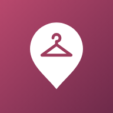
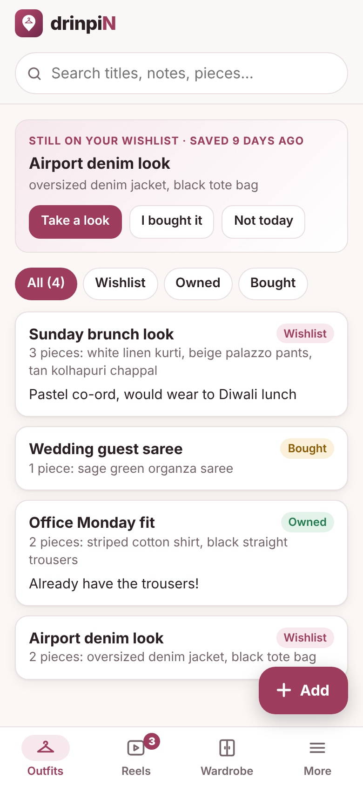
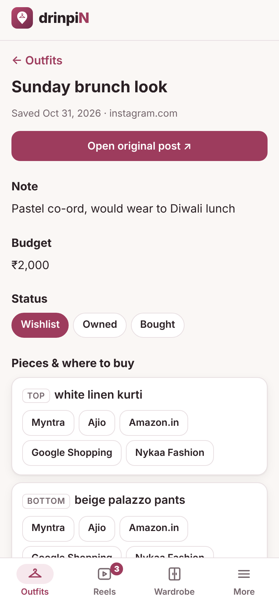
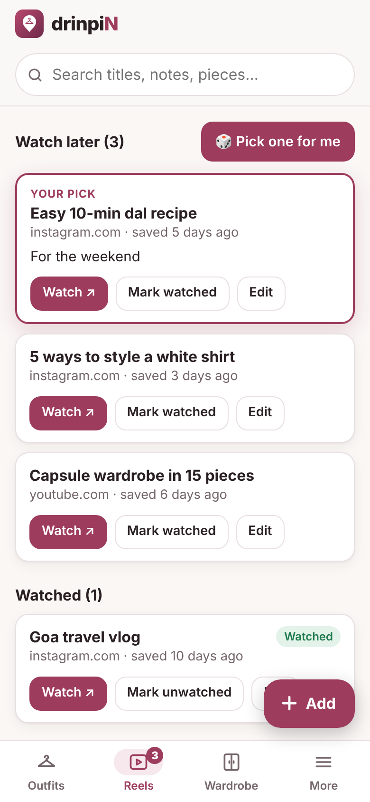

<p align="center">
  
</p>

<h1 align="center">drinpiN</h1>
<p align="center"><b>Save it. Find it. Wear it.</b><br>
Save outfit and reel links from Instagram, WhatsApp and YouTube, tag every piece, find where to buy it, and actually come back to what you saved.</p>

<p align="center">
  
  
  
</p>

---

## What it does

**Outfits**
- Save a creator's outfit link and tag each piece: top, bottom, dress, outerwear, shoes, accessory or other.
- Each piece gets one-tap search buttons for **Myntra, Ajio, Amazon.in, Google Shopping and Nykaa Fashion**.
- Mark each outfit as **Wishlist**, **Owned** or **Bought**, and add a budget.
- **Rediscover:** a wishlist outfit you saved 3 or more days ago pops back up on the home screen, so saved looks don't get forgotten.

**Reels (watch later)**
- A queue of reels you haven't watched yet.
- **🎲 Pick one for me** chooses one at random.
- The number of unwatched reels shows on the Reels tab, and on the app icon on phones that support it.

**Wardrobe**
- Every tagged piece, grouped by category.
- Filter by Owned, Wishlist or Bought, and by category.

**Everything else**
- Search across titles, notes and piece names.
- Share links straight in from other apps (Android).
- A **Paste** button on the add form.
- A warning when you try to save the same link twice.
- Tracking junk like `?igsh=` is removed from saved links.
- **Undo** after deleting something or marking a reel watched.
- **Backup and restore** to a file, and a "Delete everything" option.
- Works offline, follows your phone's light or dark mode, and offers shortcuts when you long-press the app icon.
- No account, no server, no ads, no tracking. Your data stays on your phone.

## Try it on your computer

Open a terminal in this folder and run:

```bash
python3 -m http.server 8000
```

Then open <http://localhost:8000> in Chrome. Double-clicking `index.html` also works, but offline mode and installing need a web address.

## Put it online for free

**GitHub Pages (this repository)**
1. Go to this repository's **Settings → Pages**.
2. Under **Build and deployment**, choose **Deploy from a branch**, pick branch **main** and folder **/ (root)**, then click **Save**.
3. After about a minute, the app is live at `https://drvptl2106.github.io/drinpin/`.

**Netlify (alternative)**
Drag this folder onto <https://app.netlify.com/drop>.

## Install it on your phone

- **Android (Chrome):** open the app's address, then go to **More → Install app**, or use Chrome's **⋮ → Install app**.
- **iPhone (Safari):** tap **Share → Add to Home Screen**.

Once installed, drinpiN opens full screen with its own icon, just like any other app.

## Saving a link from another app

- **Android:** once installed, **drinpiN appears in the Share menu**. In Instagram, WhatsApp or YouTube, tap **Share → drinpiN**. The link is filled in for you, and drinpiN guesses whether it's a Reel or an Outfit.
- **iPhone:** ⚠️ Apple doesn't let web apps appear in the Share menu. Tap **Copy link** in the other app instead, then open drinpiN and tap **Add → Paste**.

## Want it on the Google Play Store?

drinpiN is already a full installable app (a "PWA"), so it doesn't have to be rewritten to go on the Play Store:

1. Put it online with GitHub Pages (see above).
2. Go to <https://www.pwabuilder.com>, enter your app's address, and choose **Package for stores → Android**.
3. Upload the file it gives you to the Google Play Console. A developer account costs a one-time $25.

## Changing things

| To change… | Edit this |
|---|---|
| The shops and their search links | `stores.js`, one line per shop, where `{q}` marks the piece name |
| Colours | The variables at the top of `styles.css` |
| The logo | `icons/icon.svg`, then recreate the PNG sizes in `icons/` |
| App name | `manifest.json` and the `<title>` in `index.html` |

**After changing anything once it's online:** open `sw.js` and raise the version number (`drinpin-v2` → `drinpin-v3`). Installed apps then show an "Updated, Reload" message.

## Files

| File | What it does |
|---|---|
| `index.html` | The page itself |
| `styles.css` | Colours and layout (light and dark mode) |
| `app.js` | All the screens and buttons |
| `storage.js` | Saves and loads items in browser storage (key `saver.items`) |
| `stores.js` | Shop search links |
| `manifest.json` | Name, icon, Share menu, home-screen shortcuts |
| `sw.js` | Keeps a copy of the app so it works offline |
| `icons/` | Logo and app icons |
| `screenshots/` | Pictures shown in the install dialog and in this README |

## Good to know

- Your data lives only in the browser where you saved it, and doesn't sync between devices. Use **More → Download backup** before changing phones, then **Restore from backup** on the new one.
- drinpiN saves only links and text, never photos or videos.
- The shop buttons open each store's own search page. drinpiN doesn't collect prices or scrape any website.
