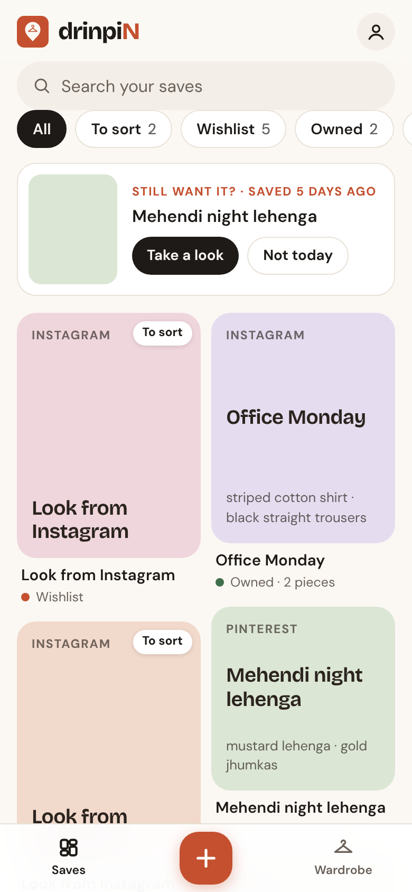
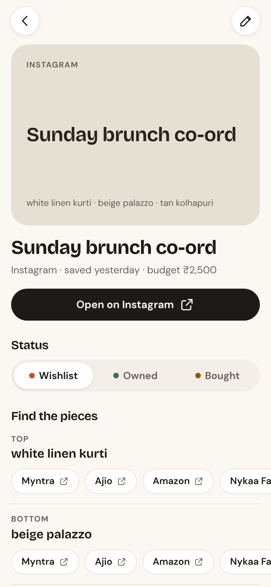
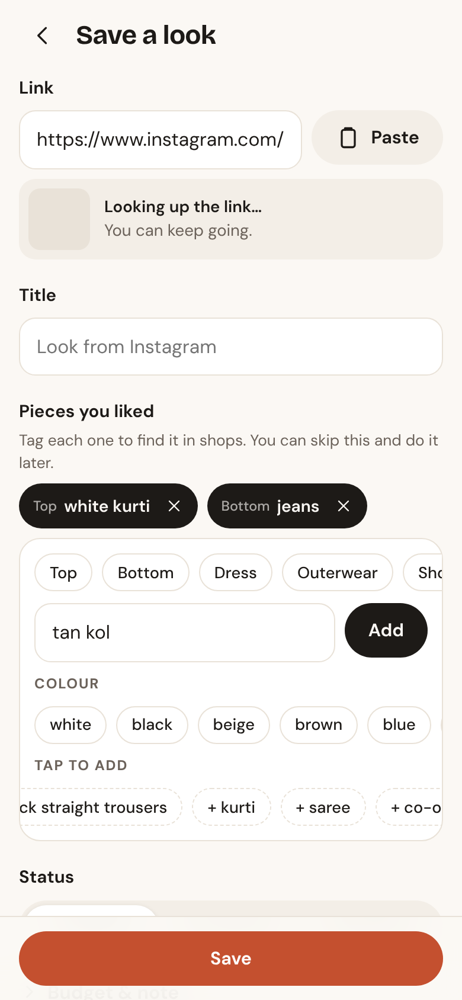

<p align="center">
  
</p>

<h1 align="center">drinpiN</h1>
<p align="center"><b>Save the look. Find the pieces.</b><br>
Save outfit links from Instagram and anywhere else, tag every piece, and shop each one in a tap.</p>

<p align="center">
  
  
  
</p>

**Live app:** <https://drvptl2106.github.io/drinpin/>

## What it does

- **One-tap save.** Share a post from Instagram (or any app) to drinpiN and it's saved instantly. Tag the pieces now, or later from **To sort**.
- **Quick tagging.** Tap a colour, then a piece (*white → kurti*), and it's tagged. Typing works too, and the category is guessed (*sneakers → Shoes*). Your own past tags are suggested first.
- **Find the pieces.** Every tagged piece gets search buttons for Myntra, Ajio, Amazon, Nykaa Fashion and Google Shopping.
- **Pictures and titles filled in automatically** for shop links, Pinterest and YouTube (Instagram usually blocks this, so those show a coloured tile).
- **Accounts and sync.** Sign in with a 6-digit email code (or Google) to back up your saves and see them on every device.
- **Works offline.** Saving is instant and never waits for the internet; changes upload when you're back online.
- **Wardrobe:** all your pieces by category, filtered by Owned, Wishlist or Bought.
- **Rediscover:** a wishlist look you saved days ago comes back to remind you.
- Duplicate-link warnings, search, undo, backups, and light and dark mode.

## Setting up the database

See **[SETUP.md](SETUP.md)** for a step-by-step guide, written for non-programmers. Without it, the app still works, with saves stored only on each device.

## For developers

Built with React, TypeScript and Vite. It's an installable PWA with an Android share target. Supabase provides Postgres with row-level security, email-OTP auth, and an Edge Function for link previews.

```bash
npm install
cp .env.example .env   # add your Supabase URL + anon key (optional)
npm run dev            # http://localhost:5173
npm test               # sync engine, link helpers, and the SQL schema on real Postgres (PGlite)
npm run build
```

| Path | What's there |
|---|---|
| `src/lib/outfitStore.ts` | Offline-first store and sync engine (local first, then upload and download; newest edit wins) |
| `src/lib/supabaseRemote.ts` | The store's connection to the `outfits` table |
| `src/app/startup.ts` | One-tap share saving and moving data over from version 1 |
| `src/components/PieceTagger.tsx` | Quick tagging (colours, suggestions, category guessing) |
| `src/screens/` | Home, Detail, Editor, Wardrobe, Profile, Sign-in, Welcome |
| `src/lib/stores.ts` | Shop search links; edit here to add or change shops |
| `supabase/schema.sql` | Table, security rules, newest-edit-wins trigger |
| `supabase/functions/link-preview/` | Fetches a page's title and picture (blocks private and internal addresses) |
| `.github/workflows/deploy.yml` | Tests, builds and publishes to GitHub Pages on every push to `main` |

### How syncing works

Every change is written to the device first, so it's instant and works offline, and marked "waiting". When signed in, waiting changes are upserted to Supabase, then rows changed since the last download (by the server-set `synced_at`) are pulled. A database trigger ignores any update older than the stored `updated_at`, so the newest edit wins even when it arrives late. Deletes are stored as a `deleted_at` marker so other devices learn about them.

### Privacy

No ads and no tracking. Shop buttons open each store's own search page, and drinpiN never collects prices. Saved data is visible only to its owner (Postgres row-level security).
